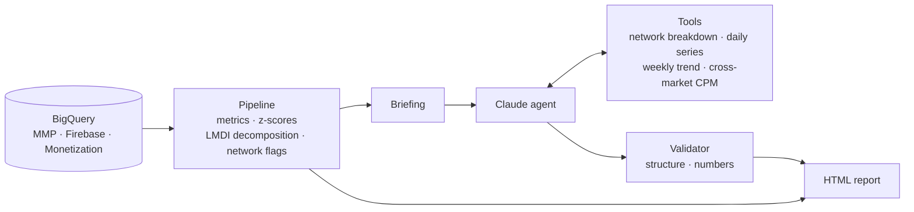

# LTV Driver Agent

**Why did LTVD1 change this week?** This project answers that question for a mobile game, one geo and platform at a time. A Python pipeline computes and decomposes the week-over-week change in day-1 lifetime value; a Claude agent then investigates the drivers with tools and writes an explanation a monetization lead can act on. An evaluation harness measures how often the agent finds the real cause, using synthetic data with planted ground truth.

> *GB Android LTVD1 looks flat, but only because a Mintegral interstitial CPM jump offset a loss of rewarded volume after AdMob stopped serving rewarded ads.* (agent output, dev set)

**Design principle: Python calculates, Claude reasons.** Every number comes from tested code. The agent decides which questions to ask, interprets the answers and explains them, and a validator checks that every number it writes was actually given to it.

<!-- Add screenshots: docs/report.png (an HTML report) and docs/scorecard.png (an evaluation scorecard) -->

## Results

The agent was evaluated on 72 runs across three sets of synthetic markets with planted causes (3 runs per market, since the model is not deterministic):

| Set | What it tests | Detectable causes found | False alarms |
|---|---|---|---|
| Dev | The hand-built world used during development | 23/24 | 0 in 24 runs |
| Stress | Deliberately hard cases (see below) | 12/15 | 2 in 24 runs, none at high confidence |
| Test | A fresh random world, run once after tuning | 15/15 | 0 in 24 runs |
| **Total** | | **50/54 (93%)** | **2 in 72 runs** |

- A planted data-pipeline failure (missing D1 data) was recognized as a data problem in 3/3 runs, not reported as a retention collapse.
- 0 runs with unverified numbers, 0 errors.
- About $0.04 per run with prompt caching (73% of input tokens served from cache, 38% cheaper than uncached).

**Known limitation:** the agent occasionally labels a real but near-threshold D1 retention change as normal variation (2 of 48 runs on dev and stress). This is the price of the rule that cut false alarms, documented below.

## How it works



### 1. Data

Three sources, as in a typical ad-monetized game:

| Source | Grain | Used for |
|---|---|---|
| MMP | Install date | Installs and cohort revenue: the reference LTVD1 |
| Firebase | Install date × age (D0/D1) × event type | Retention, impressions per user by ad type, LTV cross-check |
| Monetization networks | Date × network × ad type (all users, not cohorted) | CPM by ad type and network |

The data is synthetic (16 weeks, 8 geo/platform markets), generated by one simulated game and "measured" three ways, with realistic gaps between sources, volume-dependent noise, day-of-week patterns and a Q4 CPM ramp. It's loaded into BigQuery with explicit schemas and queried with parameterized SQL (the Firebase query pivots long event rows to one row per install date with conditional aggregation). A local CSV mode runs everything without BigQuery.

### 2. Analysis

**The model.** Ad revenue per install over D0–1, by ad type *t* and network *n*:

```
LTVD1 = Σ_t Σ_n [ x0_t + R1 · x1_t ] · s_tn · p_tn / 1000

x0_t  D0 impressions per install          R1    D1 retention
x1_t  D1 impressions per D1 active user   s_tn  network share of impressions   p_tn  network CPM
```

Separating D1 impressions *per active user* from retention keeps engagement and retention from being double-counted.

**Decomposition.** The week-over-week change is split with LMDI (Log Mean Divisia Index): contributions add up exactly to the total, with no interaction residual and no dependence on the order of factors. Because CPM is modeled per network, each CPM change splits into **price effects** (a network's own CPM moved) and **mix effects** (impressions moved between networks). The model uses all-user CPMs, so it never equals MMP LTV exactly; the ratio between them is treated as one more factor, which makes the "unexplained" part explicit instead of hiding it.

**Signals.**
- z-scores compare each metric's weekly change with its previous 12 weekly changes.
- MMP and Firebase are compared on their changes, not their levels (which differ structurally).
- Changes are reported in points of LTV change. "% of the change" is shown only when the change is large and mostly in one direction: with offsetting drivers it produces meaningless numbers like −500%.
- Network flags look for network-specific events (CPM relative to the ad type, share shifts, mix effects). Across 20 random worlds, noise-only markets were flagged in 1 of 80 cases.

### 3. Agent

The agent receives a **briefing** with the pipeline's results (drivers, key metrics with z-scores, flags, a network summary for every ad type, data-quality issues) and investigates with four tools:

| Tool | Question it answers |
|---|---|
| `get_network_breakdown` | Which network moved: price or mix? |
| `get_daily_series` | A step on a specific day (release, SDK) or a gradual drift? |
| `get_weekly_trend` | New, part of a trend, or noise? |
| `compare_cpm_across_markets` | Specific to this market, or market-wide (seasonality)? |

It finishes by calling `submit_findings`, a structured answer where each driver has an explanation, a confidence level and a **verdict**: `specific_issue`, `market_wide` or `normal_variation`. Driver names are an enum built from that week's drivers table, so the agent can only attribute the change to drivers that exist.

**Guardrails.**
- **Number validation:** every quantitative claim in the agent's text (numbers with %, pp, pts, $ or decimals) must match a number it received, allowing for rounding and for sums of contributions. Matching is unit-aware: a claim in points can only match points.
- **Structure validation:** malformed answers (e.g. an array sent as a JSON string) are repaired if possible, otherwise sent back to the model with a specific error.
- A tool budget, a turn limit, tool errors returned to the agent instead of crashing, and a rule-based summary as fallback if the API is unavailable.
- **Prompt caching** of the repeated prefix (tools, system prompt, earlier turns), with token and cost accounting per run.

The HTML report shows the agent's narrative, suggested next steps and caveats, plus a trace of its investigation: its reasoning before each tool call and the data it received.

### 4. Evaluation

Evaluating an analysis agent on real data is hard because the true cause is usually unknown. So the data is synthetic with **planted causes**: a network's CPM jumps, engagement drops from a given day, a network stops serving, retention falls. Each scenario's true effect is measured with a **counterfactual**: the same world is regenerated without the scenario, with identical noise, and the difference is the scenario's effect in points.

**Scoring** uses only the agent's structured findings, not its wording:

- **Found:** the agent lists the scenario's driver as a `specific_issue`. Naming it but calling it noise is a miss.
- **False alarm:** a `specific_issue` that matches nothing planted.
- **Materiality:** effects under 1 point are minor; finding them is a bonus, missing them isn't a failure.
- **Detectability:** noise can hide a real effect. A material scenario counts as detectable only if the data shows at least 0.75 points in the right direction; undetectable misses are reported separately, not blamed on the agent.

**Three sets:**

- **Dev:** the hand-built world, used for development.
- **Test:** random worlds from a seed (random targets, networks, sizes, start days, controls), not inspected during tuning. A new seed is used after each round of tuning.
- **Stress:** each market tests one way to get it wrong:

| Trap | What a good answer does |
|---|---|
| Two causes on the same ad type pulling in opposite directions | Names both, although revenue barely moved |
| A real retention drop on the last cohort only | Reports it: clean data, sources agree |
| The same symptom caused by missing data | Recognizes a data problem |
| A six-week erosion | Describes a trend, not a one-off |
| A network event below every flag threshold | Finds it without a flag |
| A near-threshold effect that this week's noise happened to hide | Nothing can find it: the scoring must not blame the agent |
| A noise metric at z = +5 in a control | Calls it normal variation |

**What the evaluation changed.** Dev and the first test world scored 100%, so a stress set was built to find limits. It found two real ones: the agent rarely looked at networks unless a flag pointed there, and it tended to treat any unusual move as real. Two changes followed: a network summary for every ad type in the briefing, and a rule to weigh a driver's size in points as well as its z-score. On the stress set, false alarms fell from 7 to 2 in 24 runs at the same recall. The fix held on a fresh test world (15/15, no false alarms). The cost was the retention limitation noted above.

**Limitations of the evaluation.** The synthetic world is simpler than reality (independent causes, well-behaved noise). Samples are small (3 runs per market), so differences of one run are within noise. Recognition of data issues is scored with keywords, the one heuristic in the scoring. A single model was evaluated.

## What a production version would add

- A **golden set of real weeks** whose causes were confirmed later (incident reviews, release notes, network outages): the most valuable evaluation layer, which synthetic data can't replace.
- An **events log** tool (releases, A/B tests, ad config changes) for the agent to check against.
- **LLM-as-judge** scoring of explanation quality, calibrated against expert grades.
- In-app purchase revenue, UA channel breakdowns and user-mix effects.
- A model comparison (e.g. Haiku vs Sonnet) on the stress set, to choose the cheapest model that's good enough.

## Running it

Requirements: Python 3.10+, and for BigQuery mode a Google Cloud project and the gcloud CLI.

```bash
pip install -r requirements.txt
cp .env.example .env            # BigQuery project/dataset, ANTHROPIC_API_KEY

# Data
python generate_data.py --no-upload        # local CSVs only
python generate_data.py                    # + upload to BigQuery (after: gcloud auth application-default login)

# Weekly analysis
python main.py --geo US --platform ios --source csv --open
python main.py --geo GB --platform android --open          # BigQuery
python main.py --geo US --platform ios --no-agent          # rule-based summary, no API calls

# Evaluation
python evaluate.py --set dev --plan                        # cases and true effects, no API calls
python evaluate.py --set stress --runs 3 --open
python evaluate.py --set test --seed 2028 --runs 3
python compare.py outputs/eval/<before> outputs/eval/<after>

# Tests (79, no API calls; the agent loop is tested with a scripted fake client)
pytest
```

## Project structure

```
├── main.py                  weekly analysis: pipeline, agent, report
├── evaluate.py              run the agent on an evaluation set and score it
├── compare.py               compare two evaluations side by side
├── generate_data.py         generate synthetic data, upload to BigQuery
├── config.yaml              thresholds, agent settings, evaluation settings
├── synthetic.yaml           the simulated game and the dev-set scenarios
├── stress.yaml              the stress-set scenarios
├── src/
│   ├── data/                synthetic generator, BigQuery, SQL queries, loader, quality checks
│   ├── metrics/             weekly metrics, CPMs, LMDI decomposition, flags, comparisons
│   ├── pipeline.py          one function, one result object for every consumer
│   ├── agent/               tools, prompts, loop, validation, cost
│   ├── report/              HTML report (Jinja2, inline SVG charts)
│   └── eval/                cases, scoring, runner, scorecard
└── tests/
```

## Engineering notes

A few problems found along the way, each a general lesson:

- **Normalize types where data enters the code.** BigQuery returns nullable dtypes (`pd.NA` instead of `NaN`), which crashed code that worked on CSVs. Conversion now happens once, in the loader, and a test mimics BigQuery's types.
- **A schema guides the model but doesn't guarantee its output.** The model sometimes sent an array as a JSON string. Answers are now repaired or sent back, never trusted blindly.
- **Test with more than one seed.** A new random seed exposed a "−500% of the change" bug and a seasonality-driven false flag that the original world hid.
- **Textbook isn't always exact.** The standard epsilon fix for zeros in LMDI leaked about 2% of a change into the wrong factor; the exact limit is used instead.
- **Matching numbers by value alone is permissive.** The more numbers the agent has seen, the more likely an invented one matches by chance; matching became unit-aware.

---

Built by Oren Magen, mobile games growth and monetization. <!-- add LinkedIn / contact -->
